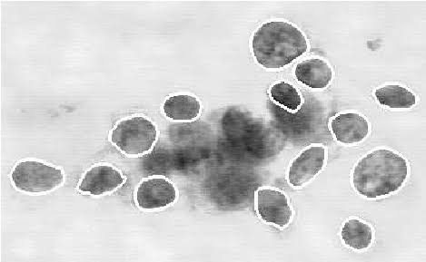

# AgenticCellMorph

A pydantic-ai multi-agent system that performs statistical analysis of 
Cell Morphology CSV tables and predictive analysis using logistic regression. 
The system consists of 4 different agents:

- An agent parses CSV files and performs data validation.
- An agent performs statistical analysis on the data including a test to 
determine if some variables are strongly correlated.
- Another agent performs machine learning analysis via logistic regression. 
This agent may receive the full set of features or a subset of features after 
removing strongly correlated features (i.e., removing multicollinearity conditions). 
- Another agent compiles statistical results, prediction results, and SHAP-based 
explainability results. This agent summarizes the results in a final report for human consumption. 


The data sequence is:

```
prompt → parser agent → EDA agent → [correlated features?] → modeling agent 1 or 2 → summary agent
```

| Agent | Role | Output |
|---|---|---|
| Parser | Extracts the CSV path, feature list and target from free text; validates them against the file | `AnalysisRequest` |
| EDA | Statistics, target balance, correlation matrix, strongly correlated pairs, figures | `EDAReport` |
| Modeling | Stratified 80/20 split, 5-fold cross-validation, validation metrics, model coefficients, SHAP | `ModelReport` |
| Summary | Interprets everything, compares the runs, explains the predictions | `FinalReport` |

The orchestrator (`orchestrator.py`) is a plain Python script (not an agent). 
If the EDA agent finds correlated
pairs, it greedily drops features until none remain above the threshold (|r| = 0.8) and runs the modeling agent twice, with all features and with
the uncorrelated subset, on the **same split and CV folds**. It then computes
a paired comparison for the summary agent.

The agents decide which tools to call and interpret the results, but every
numeric outcome comes from the tools (pandas, scikit-learn, shap).

## Use Cases
The system can be used to process any type of CSV tables that include feature 
variables and target variables. As initial example, it has been used with 
data tables from the Wisconsin Breast Cancer (Diagnostic) dataset. 


The dataset can be found at https://archive.ics.uci.edu/dataset/17/breast+cancer+wisconsin+diagnostic


The dataset consists of a table summarizing morphology and texture features from 
images of fine-needle aspirate (FNA) samples of breast cancer patients. The table 
contains 568 rows, each row describing a case (i.e., an image like the one seen here). 
Each case is characterized using 10 main cell nuclei statistics extracted from an image: mean values for radius, 
texture, perimeter, area, smoothness, compactness, concavity, concave points, symmetry, and 
fractal dimension. A second set of 10 features provides the standard error values, and a third set of 
10 features provides the worst measurement (i.e., the mean of the largest 3 values). The table
also includes a diagnostic column with values B (benign) or M (malignant). 
Morphology cell
features are used as variables that predict the diagnosis. 

For the purpose of this 
project, the table has been formatted for quick Pandas acquisition. We create two tables in 
the `data` subdirectory, one that contains only 10 features (mean values), and the second one that matches 
the original table with 30 features. 

Tables `cbc_10feats.csv` and `cbc_30feats.csv` were used as inputs to the agentic system 
described here. The automatically generated reports are found in `outputs10` and `outputs30` 
directories.
<br clear="left">

## Project setup
Download the code to your local file system. Also, ensure you have an API key for the LLM provider of 
your choice. Change directory to the project's directory and run:
```bash
uv sync
export ANTHROPIC_API_KEY=...
```

The current provider and model is set in one place: `LLM_MODEL` variable 
in `src/agenticcellmorph/config.py`
By default, it is set to `anthropic:claude-haiku-5-5`. Update this variable 
if you prefer to use a different provider and model.


## Usage
After preparing the CSV table, the agentic system can be called using a prompt 
or explicitly listing separate arguments. In both case, the user must provide 
the list of feature variables and the designated target variable. 

Using a prompt:
```bash
uv run agenticcellmorph "Analyze data/sample.csv. Features: area, perimeter, nucleus_area, circularity, mean_intensity, texture_contrast, cell_line. Target: phenotype."
```

Alternatively, use explicit arguments:

```bash
uv run agenticcellmorph --csv data/sample.csv --features area,perimeter,circularity --target phenotype
```

Other options: `--output-dir` (default `outputs/`) and `--model` (overrides `config.LLM_MODEL`).

Outputs in the output directory:
- `report.md`: the final report
- `results.json`: every report and metric
- `figures/`: distributions, correlation heatmap, features by target, and the SHAP importance and beeswarm plots for each run

`data/sample.csv` is synthetic cell-morphology data with a correlated group
(area, perimeter, nucleus_area). Regenerate it with `uv run python scripts/make_sample_data.py`.

## Tests

```bash
uv run pytest
```

The tests use pydantic-ai's `TestModel`, so they make no API calls.
